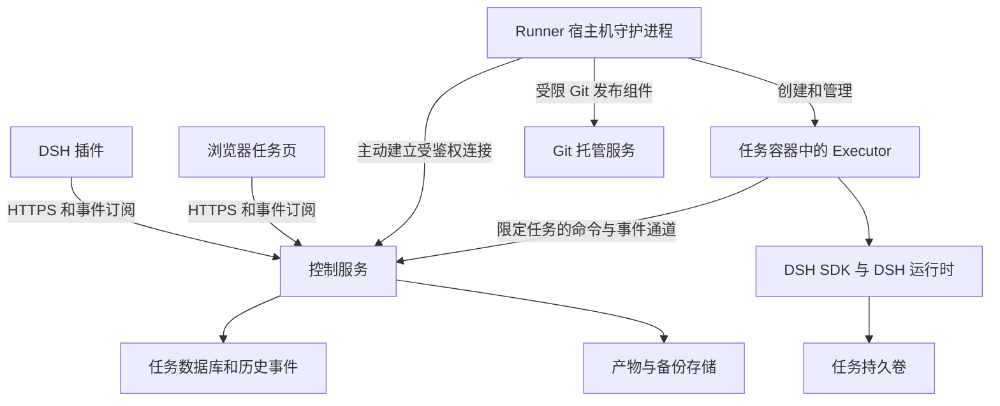
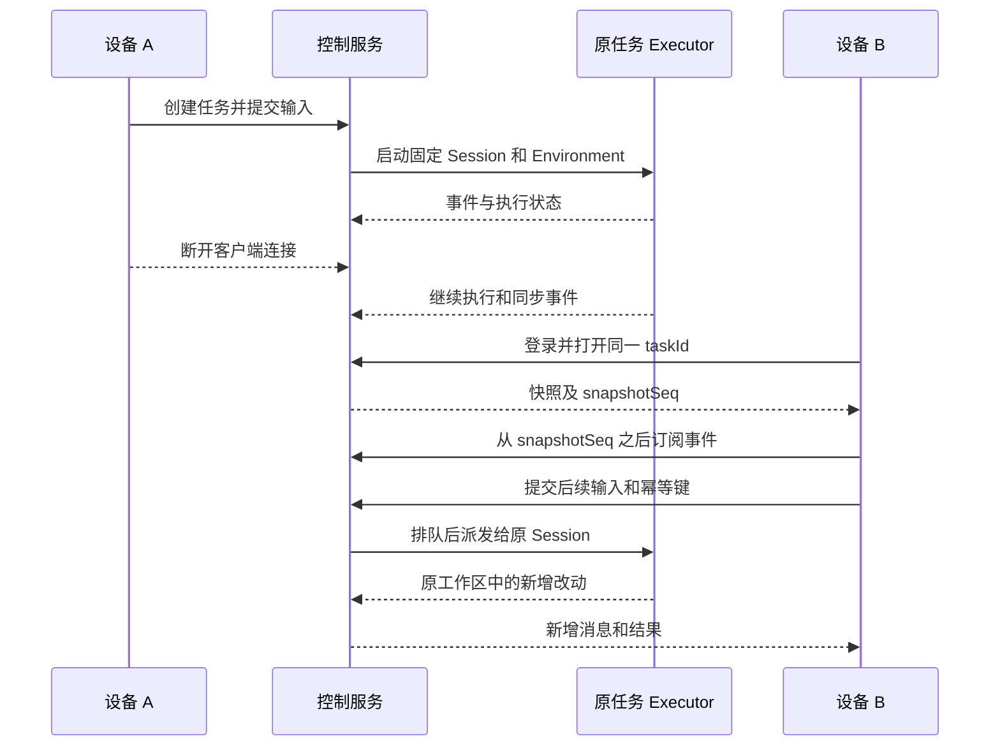
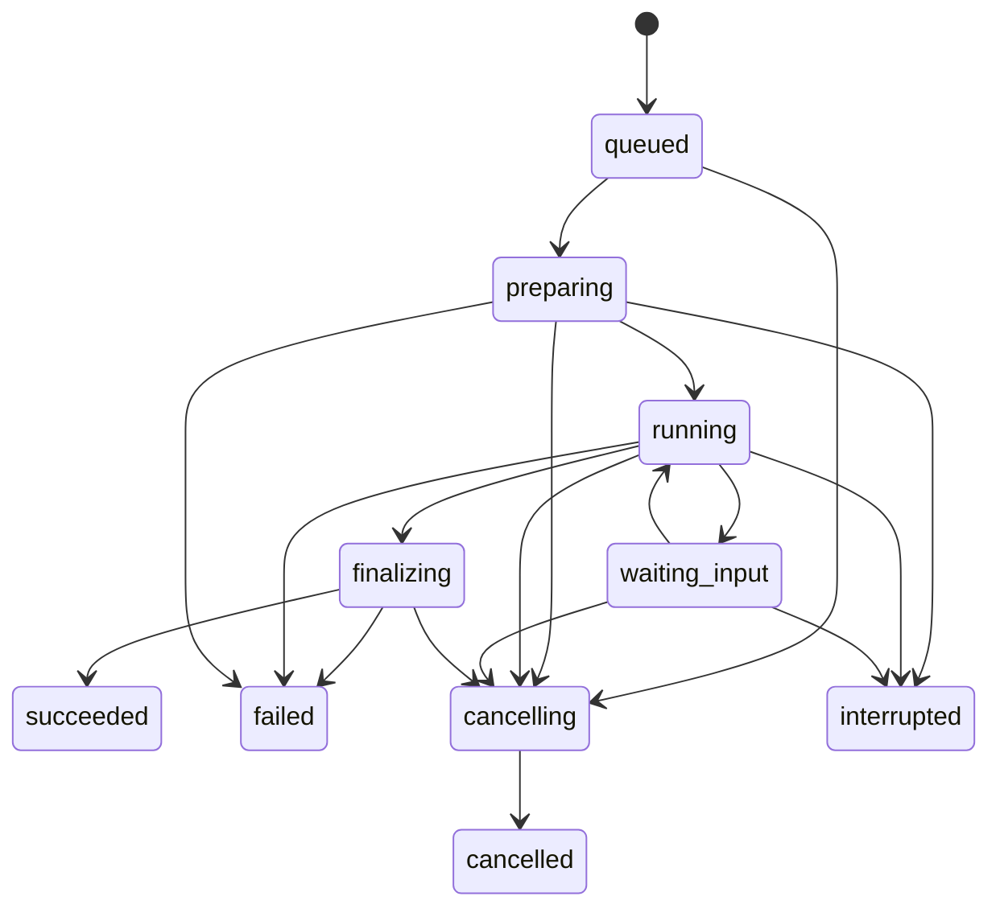

# DSH 云任务设计方案与 MVP 实现计划

用户从任意已登录设备打开同一个云任务，应看到同一段会话、同一份工作区和同一个执行状态，并能继续追问。个人电脑、闲置 Mac、自有服务器和云服务器统一注册为 Runner；任务选择环境后，由远程服务持续管理，不依赖发起任务的客户端保持在线。

方案采用 **DSH 插件、控制服务、Runner** 三部分。每个任务固定绑定一个主 DSH 会话和一个持久任务环境；每次追问产生新的 Run，并复用这组绑定。MVP 面向同一用户跨设备使用，首先支持 Linux 服务器和运行 Linux 容器的 macOS 电脑。

设计日期：2026 年 11 月 2 日。技术基线为 DSH 提交 `ce7073d51254c26cd63b22a60835b8f948deb447`，仓库及 SDK 包标注版本为 `0.2.2-alpha.2`。实现时锁定这组运行时、SDK 和插件依赖，经兼容性验证后升级；该版本号仅表示核对的源码版本，不代表已经验证 npm 分发或目标机器安装。[源码基线](https://github.com/deepseek-ai/deepseek-harness/blob/ce7073d51254c26cd63b22a60835b8f948deb447/package.json)、[SDK 包](https://github.com/deepseek-ai/deepseek-harness/blob/ce7073d51254c26cd63b22a60835b8f948deb447/packages/sdk/client/package.json)

# 产品目标和首版边界

## 已确定的产品方向

- 用户通过 DSH 发起、查看和继续云任务，任务可以在关闭客户端后继续运行。

- 个人电脑和服务器是同一种执行节点，使用相同的注册、调度和管理协议。

- 同一任务跨设备访问同一会话与环境，设备切换只是重新连接已有任务。

- 任务结果包括会话、代码改动、检查记录、产物，以及可选的 PR。

- 用户可以选择自己的执行节点，环境位置及网络能力由该节点决定。

## MVP 的工程默认值

首版采用一个控制服务实例、一个账号的多设备访问、多个可注册 Runner、每个任务一个独立容器和持久卷。创建时明确模型路由、运行预算及交付策略（仅保存结果或自动创建 Draft PR）。每个 Runner 默认同时运行一个任务，可在资源足够时提高并发。任务创建时指定 Runner；已绑定任务始终回到原节点。

代码输入采用一个远程 Git 仓库及明确的起始 commit。任务运行期间的追问按顺序排队。文件浏览和 Diff 通过远程任务环境提供。首版不提供客户端本地目录上传、执行中强制插入输入、共享账号之外的协作权限、跨节点自动迁移、整机远程桌面或任意交互终端。

浏览器提供轻量任务页，与 DSH 插件复用同一套任务视图和服务接口，使没有安装 DSH 的设备也能登录查看、追问和处理任务问题。插件仍是主要入口。

# 核心对象和一致性要求

| 对象 | 含义 | 生命周期 |
|---|---|---|
| Task | 用户持续跟进的工作项，拥有稳定的 taskId | 创建到删除，允许多次追问 |
| Session | Task 对应的主 DSH 会话，保存模型上下文和工具历史 | 跨 Run 和客户端持续保留 |
| Run | 一次用户输入触发的执行 | 排队、执行、完成或中断 |
| Attempt | Run 的一次具体进程执行尝试 | 用于区分重启、恢复和旧进程 |
| EnvironmentTemplate | 镜像、依赖准备、检查命令和资源配置的不可变版本 | 可供多个任务复用 |
| TaskEnvironment | 一个任务专属的工作区、DSH 数据和执行实例 | 任务存续期间保留 |
| Runner | 承载任务环境的机器及其守护进程 | 注册、在线、离线、撤销 |
| Interaction | 任务提出的问题或单次操作授权请求 | 待答、已提交、已解决或失效 |
| Artifact | Diff、文件、检查日志、报告等交付物 | 随任务保存并按保留策略清理 |

MVP 保持 `Task 1:1 主 Session 1:1 TaskEnvironment`，`Task 1:N Run`，`Run 1:N Attempt`。每个 Task 最多有一个持有执行权的 Attempt；每个环境最多有一个写入中的 DSH 运行时。任务下的自动子 Agent、Goal 和定时调度暂不启用，避免把后台子工作误判为根任务已结束。

“同一个会话”意味着继续使用相同的 DSH session ID 和原生持久日志。界面聊天副本用于展示，不能用复制聊天文本的方式创建新会话代替恢复。

“同一个环境”分两种情况：运行期间，所有设备观察同一容器、文件系统和进程；容器或机器重启后，使用同一 environment ID、持久卷、工作区路径和 DSH 数据恢复。重启会产生新的 runtime incarnation，Shell、浏览器和服务进程需要重新启动。

同一模板创建的两个任务具有不同工作区、会话和分支。一个任务执行完成只结束当前 Run，环境继续保留，后续输入仍回到原任务。

# 总体架构和职责



Runner 包含宿主机守护进程和任务容器内的 Executor。守护进程负责机器与容器；Executor 持有 SDK 实例和 DSH 子进程。它们都主动连接控制服务，使用不同范围的凭据。家庭网络中的 Runner 无需开放公网监听端口。

| 部分 | 负责的内容 | 权威状态和边界 |
|---|---|---|
| DSH Client 插件 | 任务列表、会话视图、输入、待答问题、文件、Diff 和结果 | 保存筛选条件与事件游标等界面状态；任务归属由服务端确定 |
| DSH Host 插件 | 登录会话、云 API 适配、模型工具、Client Remote 接口 | 凭据不进入浏览器组件；本地聊天只记录云任务引用 |
| 控制服务 | 身份、任务和输入顺序、执行权、事件入库、待答项、节点注册、产物索引、发布授权 | 是任务命令、队列、权限和跨设备展示状态的权威来源 |
| Runner 守护进程 | 配对、心跳、能力上报、容器与卷、资源限制、进程核对、Git 发布 | 是所管理容器及本机环境实际存在状态的执行者 |
| Executor | SDK 生命周期、单任务执行队列、事件转发、问答转接、停止和恢复协调 | 一次只驱动本任务的主 Session，不能领取其他任务 |
| DSH 运行时 | 模型循环、文件及命令工具、上下文、原生会话日志 | 原生会话日志是模型上下文的权威来源 |
| 持久卷和产物存储 | 工作区、DSH home、依赖、附件、日志、Diff | 文件事实来自任务环境；控制服务区分实时读取和已上传快照 |

控制服务记录“希望发生什么”，Runner 上报“已经发生什么”。例如，取消请求入库后只能显示“取消中”；收到进程停止确认后才显示“已取消”。SDK 的返回文本、测试状态和 PR 发布状态分别记录，避免把模型说“完成了”当作测试通过。

## DSH 插件接入方式

Client 插件通过 UI Slots 提供云任务入口，Host 插件通过自定义 Remote 服务调用控制服务。模型侧注册 `cloud_start`、`cloud_list`、`cloud_get`、`cloud_followup`、`cloud_cancel` 和 `cloud_publish`；这些名称是本项目新增工具。

打开云任务面板时，界面直接绑定远程 taskId。模型工具调用只返回云任务 ID、状态和链接，随后的本地模型回复不承担远程任务的执行或会话维护。这样同一云任务不会因为在另一台 DSH 上打开而产生第二个 Agent。

DSH 已提供 `ctx.tools.register()`、UI Slots 和 Typert Remote；插件可通过现有 bundle 和 profile 机制安装。[工具定义](https://github.com/deepseek-ai/deepseek-harness/blob/ce7073d51254c26cd63b22a60835b8f948deb447/docs/cookbook/adding-a-tool.md)、[UI Slots](https://github.com/deepseek-ai/deepseek-harness/blob/ce7073d51254c26cd63b22a60835b8f948deb447/packages/client/ui-slots/README.md)、[Remote API](https://github.com/deepseek-ai/deepseek-harness/blob/ce7073d51254c26cd63b22a60835b8f948deb447/docs/api-gateway.md)、[插件架构](https://github.com/deepseek-ai/deepseek-harness/blob/ce7073d51254c26cd63b22a60835b8f948deb447/docs/architecture.md)

# DSH 复用能力和需要补齐的适配层

| 能力 | 当前 DSH 能力 | 本项目的实现 |
|---|---|---|
| 启动运行时 | TypeScript SDK 启动 sdk profile | 在任务容器内由 Executor 持有 SDK |
| 执行输入 | run、session/prompt、session/query | 同一任务串行派发，记录输入和 Run |
| 恢复会话 | resumeSession 和 session/resume | 保留原 home、路径及 session ID，恢复后另行提交续跑输入 |
| 观察进度 | session.event 和 session.status | 规范化事件、持久化副本、SSE 重放 |
| 读取旧历史 | resume 不重新发送旧事件 | 使用持久化读取适配层补读 |
| 持久化屏障 | SessionPersistence.flush | 在检查点及最终完成前调用并记录 durable seq |
| 用户问题和操作授权 | onUserQuestion、approval/request | 转成跨设备 Interaction，答案按运行实例校验 |
| 取消执行 | 当前 SDK 没有独立 cancel 方法 | 关闭本任务 SDK，并由容器管理确认整个进程树停止 |

以上 SDK 能力及限制来自当前接口：`close()` 关闭其拥有的运行时；`resumeSession()` 恢复持久历史，但不恢复外部进程，也不自动提交新输入；SDK 的超时只终止等待，不能代表工作已回滚。[SDK 客户端](https://github.com/deepseek-ai/deepseek-harness/blob/ce7073d51254c26cd63b22a60835b8f948deb447/packages/sdk/client/README.md)、[SDK 协议](https://github.com/deepseek-ai/deepseek-harness/blob/ce7073d51254c26cd63b22a60835b8f948deb447/packages/sdk/protocol/README.md)

增加一个小型 `dsh-cloud-runtime` Host 插件，随任务 profile 加载，作为 Runner 内部适配层。它通过容器内私有 IPC 提供 `flushCheckpoint`、`readPersistedEvents` 和 `inspectSession`，仅服务当前任务 Executor。上述方法是新增协议，不是现有 DSH SDK 方法。

适配层调用公开的 `ctx.sessionPersistence.flush()` 和 `open(id, 'read')`，再按 seq 读取持久事件；不直接修改 JSONL 文件，不承担第二个会话写入者。需要读取附件时同时解析任务内受限的附件引用。[持久化服务接口](https://github.com/deepseek-ai/deepseek-harness/blob/ce7073d51254c26cd63b22a60835b8f948deb447/packages/session/session-persistence/src/index.ts)、[读取和 flush 契约](https://github.com/deepseek-ai/deepseek-harness/blob/ce7073d51254c26cd63b22a60835b8f948deb447/packages/session/session-persistence/src/handle.ts)

DSH 的 `session/event` 会先进入持久化缓冲，因此实时通知与持久化检查点分开处理。原生存储格式变化通过 DSH 的读取和迁移接口处理，项目侧不编写只兼容当前 JSONL 行结构的解析器。[持久化写入流程](https://github.com/deepseek-ai/deepseek-harness/blob/ce7073d51254c26cd63b22a60835b8f948deb447/packages/session/session-persistence/README.md)、[JSONL 恢复语义](https://github.com/deepseek-ai/deepseek-harness/blob/ce7073d51254c26cd63b22a60835b8f948deb447/packages/session/session-persistence-jsonl/README.md)

# 跨设备访问同一任务的流程

## 创建并首次执行

1. 设备 A 选择已注册 Runner、环境模板版本、仓库及起始引用，提交任务和首条输入，并携带客户端生成的幂等键。

2. 控制服务在一个数据库事务中创建 Task、Session 绑定、TaskEnvironment、首个 Run、输入记录和待派发命令。Task、环境和 DSH session ID 在第一次执行前就确定。

3. Runner 领取带执行代次的命令，先在本地日志中记下 command ID，再准备专属卷与容器。仓库引用解析为固定 commit 并回写；后续执行不重新解析起始分支。

4. Executor 启动 DSH，完成 SDK initialize 和运行配置检查后，提交首条输入。控制服务分别记录“请求已保存”“运行时已接收”“正在执行”。任务容器的启动与 SDK 初始化不绑定客户端 HTTP 请求的存续时间。

5. 事件经过持久化检查点和控制服务入库后向所有设备广播。工作区和会话原始数据保留在任务卷。

## 在另一台设备继续



任务详情地址采用稳定的 `/tasks/{taskId}`。GET 任务和读取历史只做查询，不能隐式创建新 Agent、clone 仓库或恢复停止中的实例。需要运行时恢复时，由一次明确的执行命令触发。

打开任务时，服务端从一致的数据库读事务返回快照和 `snapshotSeq`；客户端随后读取并订阅大于该游标的事件。订阅端先补读数据库，再进入实时流，消除“快照读完到连接建立之间”的事件缺口。重连使用 `Last-Event-ID` 或等价的 after 参数，客户端按序号去重。

两个设备同时发送不同输入时，服务端按事务提交顺序分配 `inputOrdinal`。MVP 将后续输入排在当前 Run 之后；同一个输入因网络重试提交两次，只产生一个 Run。所有客户端都显示同一队列。

# 数据模型和权威状态

| 记录 | 主要字段 | 关键约束 |
|---|---|---|
| tasks | id、ownerId、title、sessionId、environmentId、lifecycle、deliveryPolicy、version | sessionId 和 environmentId 与本任务唯一绑定 |
| sessions | id、dshSessionId、runtimeVersion、modelRoute、durableSeq | DSH session ID 由创建时分配并持续使用 |
| environment_templates | id、version、imageDigest、platform、setup、checks、limits、configDigest | 已发布版本不可原地修改 |
| environments | id、taskId、runnerId、templateVersion、volumeId、state、generation、workspaceRevision | 一个任务一个环境；同一卷只允许一个写入实例 |
| runners | id、ownerId、name、platform、capabilities、capacity、lastSeenAt、credentialId | 身份与可见性按账号隔离 |
| runs | id、taskId、inputId、inputOrdinal、state、kind、previousRunId、result | 任务内输入序号唯一；同时最多一个已派发且未终结 Run，queued 不占执行权 |
| attempts | id、runId、executionEpoch、runtimeIncarnation、startedAt、endedAt | 旧代次不能提交当前结果或执行新命令 |
| commands | id、taskId、runId、kind、payloadHash、deliveryState、receipt | 命令可重复投递，消费记录按 ID 去重 |
| interactions | id、taskId、runId、runtimeIncarnation、nativeRequestId、kind、state、version | 一次问答只接受一个有效答案 |
| events | taskId、taskSeq、kind、runId、attemptId、nativeSessionId、nativeSeq、payload、schemaVersion | taskSeq 唯一；原生事件来源键唯一 |
| artifacts | id、taskId、runId、workspaceRevision、kind、hash、size、location | 附件查询和下载均校验任务归属 |
| publications | taskId、provider、repo、branch、commit、prId、state、operationKey | 同一发布操作及同一任务 PR 可查询和复用 |

最小外键关系为 owner → tasks → sessions/environments/runs → attempts/events/artifacts。所有 API、SSE、文件和下载授权均从 ownerId 检查；可猜测的 taskId 不提供访问权限。

控制服务存储的是命令及展示副本。DSH 原生事件保留其 session ID、seq 和格式版本；不能用控制服务的 taskSeq 覆盖原生 seq。控制服务会混合保存用户提交、节点状态、发布结果和 DSH 事件，所以它的事件序列与原生会话序列用途不同。

输入提交记录区分 `saved`、`dispatching`、`accepted` 和 `uncertain`。HTTP 已返回并不等于 DSH 已接收；DSH 已接收也不等于任务已经完成。

# 状态机和执行权

Task 的生命周期采用 `open → archived → delete_pending → deleted`。归档保留历史和环境；删除必须先停止任务，再清理工作区与产物。活跃任务不能只删除界面记录而留下失管进程。

Run 的主要转换为：



`finalizing` 表示执行已结束但检查点、历史或结果仍在同步。`succeeded` 表示本次 Agent 执行正常结束并且结果已保存。测试检查独立记录 `passed`、`failed`、`not_run` 或 `unknown`；项目指定的必需检查未通过时，任务结果页必须明确显示，并由发布策略决定是否允许 Draft PR。

Environment 使用 `provisioning`、`ready`、`busy`、`stopped`、`recovering`、`error` 和 `deleted`。Runner 的 `online/offline` 是连通性状态，不能直接替代 Run 或 Environment 的实际状态。

失去心跳时，控制服务保留上次确认的运行状态，同时标记 `reachability=offline` 和最后同步时间。租约到期阻止新派发和新发布，不能证明原进程已停止，因此不自动在另一台机器启动同一任务。

执行互斥包含三层：数据库对当前 Attempt 的条件更新、Runner 上的环境锁、容器内对卷的单写入锁。每次确认旧实例已结束后再创建新实例，并递增 `executionEpoch` 和 `runtimeIncarnation`。心跳重新连接本身不创建新 Attempt。

Runner 重启先核对已有容器标签、环境卷、Executor 身份和执行代次，能接回的继续接回。只在原实例已经结束且状态核对完成后恢复会话。MVP 对未知执行结果进入待核对状态，保留原节点绑定。

同一个 Run 的 Attempt 自动重试只覆盖尚未向 DSH 提交输入的可安全重复准备步骤。输入已经进入 DSH 后的中断，通过明确的恢复 Run 处理；原 Run 和 Attempt 保留原始结果。

# 接口和协议

以下是本项目新增的接口草案。用户接口使用登录会话或设备令牌；Runner 注册通道和任务 Executor 通道使用独立的受限身份。

| 方法和路径 | 用途 | 主要语义 |
|---|---|---|
| POST /v1/runner-pairings | 创建短期配对请求 | 一次性、限时、绑定账号 |
| POST /v1/runner-pairings/{id}/complete | 完成 Runner 注册 | 颁发可撤销的节点凭据 |
| GET /v1/runners | 列出节点和能力 | 离线节点仍可见 |
| POST /v1/tasks | 创建任务和首条输入 | 必须携带幂等键，返回 202 及 taskId、runId |
| GET /v1/tasks/{id} | 获取任务快照 | 带 snapshotSeq、版本及最后同步时间 |
| GET /v1/tasks/{id}/events | 补读和订阅事件 | SSE，支持 after 或 Last-Event-ID |
| POST /v1/tasks/{id}/inputs | 提交追问或恢复输入 | 串行排队，返回 inputId、runId |
| POST /v1/runs/{id}/cancel | 请求取消指定 Run | 返回取消请求状态，不提前声明进程停止 |
| POST /v1/interactions/{id}/answers | 提交问题或授权答案 | 校验版本、有效期和 runtime incarnation |
| GET /v1/tasks/{id}/files | 获取受限文件列表 | 标注实时读取或缓存版本 |
| GET /v1/tasks/{id}/diff | 获取改动及 workspaceRevision | 可查看已保存版本，不能把旧 Diff 标为实时 |
| POST /v1/tasks/{id}/publications | 发布固定版本并创建或更新 PR | 必须指定 Run、workspaceRevision、幂等键 |
| GET /v1/artifacts/{id} | 读取产物元数据或下载 | 每次校验任务归属 |

幂等键按账号、操作类型和资源作用域保存，并关联请求体摘要。同键同内容返回原结果；同键不同内容返回冲突。派发、取消、发布都具有独立 operation ID。任务仍在执行时的普通追问入队，输入确认显示的是队列状态。

Runner 命令至少包含 `commandId`、`taskId`、`environmentId`、`runId`、`attemptId`、`executionEpoch` 和有效期。Executor 只接受当前任务和当前代次的命令；确认消息区分收到、已持久记录、已进入 DSH 和已完成。

控制连接采用出站 WSS；网络环境不能稳定维持 WebSocket 时，可以使用有游标的 HTTPS 长轮询实现同一命令协议。HTTP REST 和 SSE 是客户端契约，后端传输替换不影响任务身份。

## SDK 派发的不确定窗口

当前 SDK 的 session/prompt 没有由调用方指定的幂等输入 ID。若 DSH 已接收输入但接收回执在崩溃中丢失，Runner 无法仅凭超时判断输入是否执行。

MVP 的处理是：派发前保存输入意图，返回回执后保存 DSH messageId；两者之间出错时标记 `uncertain`，暂停该任务后续队列，核对原生日志和已有执行状态。无法确定时由用户选择“从当前现场继续”或重新发起，系统不静默重送原输入。数据库和网络重试去重保证正常路径的单次提交，但不会对任意 Shell 或外部 API 副作用承诺 exactly-once。

# 事件同步和持久化检查点

跨设备历史采用两条有明确职责的路径：

- SDK 通知提供即时的活动状态，并触发增量同步。

- Runtime 适配层执行持久化屏障后读取原生事件，生成可恢复的会话副本。

MVP 先显示步骤、工具活动和已经完成的助手消息。逐 token 的展示需要另外接入 DSH 的实时流事件，放到后续版本；不把 SDK 的完整消息通知描述为逐 token 流。

一次增量同步按以下顺序进行：

1. Executor 收到通知，更新本地活动状态。按小批次触发 `flushCheckpoint`，初始参数可设为最多一秒或一百条事件，以实测调整。

2. Runtime 适配层调用 `SessionPersistence.flush()`，随后读取已持久化的连续事件前缀，返回 durableSeq。

3. Executor 将新增事件和 durableSeq 写入本地持久 outbox，再批量上传。

4. 控制服务以事务插入事件并去重，返回最高连续接收的 nativeSeq；Executor 确认后才回收对应 outbox 项。

5. 控制服务生成任务事件序号，通过 SSE 通知所有客户端。客户端游标丢失时可以重新加载快照。

原生事件使用 `sessionId + nativeSeq` 作为唯一键；重复键但内容摘要不同视为一致性错误。出现 seq 缺口时请求补读，不跳过缺失事件推进可恢复历史。

Run 的最终成功发布必须等待：DSH 已结束该次活动、原生持久化屏障成功、所需历史已被控制服务确认接收、结果清单与工作区版本已保存。网络中断时可显示“执行已结束，结果同步中”，保留未终结的同步阶段，直到确认完成或明确报告同步失败。

环境停止前同样执行检查点。历史补读通过 DSH 的持久化接口进行，因为 session/resume 只通知恢复后新增的事件。控制服务保存的会话展示副本与执行环境的原生日志通过 nativeSeq 对齐，禁止把新设备的空缓存写回远程历史。

# 环境创建和持续保存

环境模板包含镜像摘要、支持的平台、工作目录、依赖安装命令、启动命令、检查命令、CPU 和内存上限、超时、网络配置及凭据引用。模板发布后不可变，修改配置生成新版本；已经创建的任务继续使用原版本。

Runner 上每个任务保留以下独立内容：

```text
tasks/<task-id>/
  workspace/          仓库和未提交改动
  dsh-home/           DSH profile、会话和附件
  executor-state/     命令接收记录、事件 outbox、检查点
  artifacts/          Diff、检查日志和待上传产物
  environment.json    镜像摘要、模板版本、路径和状态
```

容器内固定使用 `/workspace` 和 `/dsh-home`，使重启后 DSH 的绝对工作路径仍然有效。宿主机守护进程的身份凭据、Docker 管理端点、模型上游密钥和 Git 发布凭据保存在任务容器之外。

创建环境时，先验证 Runner 平台、资源和 Docker 能力，再拉取固定镜像、创建持久卷、clone 固定 commit、建立任务分支、执行模板安装和健康检查。每一步保存阶段结果，失败后可定位到镜像、仓库、依赖、凭据或启动问题。

普通追问复用现有环境，不重新执行初始化脚本覆盖现场。环境已停止时使用同一卷和配置重启容器，恢复原 Session；需要重新启动的开发服务通过可重复执行的启动命令完成。安装脚本与恢复启动命令分开，恢复不会默认重新安装或更新依赖。

首次迭代由用户手动停止空闲环境；停止保留卷。自动空闲回收在后续版本增加。任务完成和归档都不自动删除持久卷。删除操作列出要清理的环境与产物，并在活动进程停止后执行。部署必须监测磁盘空间，避免磁盘写满破坏会话持久化。

MVP 的恢复范围是同一节点、同一持久卷上的重启。数据库及产物存储定期备份；任务环境可在停止后生成包含工作区、DSH home、配置和 durable seq 的一致备份。整机磁盘丢失后的自动重建及跨架构迁移属于后续能力，不能仅凭聊天记录重建相同环境。

# 用户问题和取消执行

## 跨设备问答

Executor 收到 SDK 的用户问题或单次操作授权请求后，向控制服务创建 Interaction。记录包含 taskId、runId、attemptId、runtimeIncarnation、原生 request ID、问题内容、类型和有效期；所有设备显示同一个待答项。

普通问题和操作授权在界面与数据模型中分开。授权请求明确显示目标操作及请求范围，不能把普通聊天回复自动解释成授权。MVP 仅转发用户明确提交的答案，不引入自动批准模型。

答案提交采用版本条件更新。设备 A 与设备 B 同时回答时，只有首个符合版本的答案被接收，另一个收到“已处理”的状态。控制服务先保存答案，再通过任务通道转交 Executor；只有对应运行实例确认接收后，状态才进入 delivered，原生结果完成后进入 resolved。

问题等待期间保留运行实例，不进行空闲环境回收。客户端离线不会关闭问题。DSH 运行时重启后，旧的原生请求 ID 失效，控制服务把对应问题标为 expired；恢复输入要求 Agent 重新提出仍需要的问题。旧答案不得发送给新的运行实例。

## 取消和恢复

取消指定当前 Run，携带 runId 和任务版本。Runner 尚未领取的输入可以直接从队列取消；已经开始的执行进入 cancelling。

Executor 先请求 SDK 关闭运行时，Runner 随后检查并终止该任务容器内遗留进程，确认停止后报告 cancelled。工作区和原生持久日志继续保留。停止过程中记录最后可用检查点；强制终止造成的尾部中断交给 DSH 的恢复机制处理。

取消不会撤销已经完成的文件修改、Git 推送或外部操作。结果页显示最后确认的环境和发布状态。取消后，任务的后续输入队列暂停，用户选择继续时再派发。

节点离线时，控制服务记录取消意图并显示“等待节点确认停止”，不会直接声明已取消。节点重连必须优先处理取消意图。恢复一个已中断的用户工作项时，创建 kind 为 recovery 的新 Run，关联 previousRunId，使用原 Session 和环境，明确告知 Agent 哪一步中断以及哪些外部结果尚未确认。

# Git 交付和检查结果

MVP 支持单仓库，采用固定任务分支，例如 `dsh/task/<task-id>`。Task 同时记录初始 commit、目标基线分支、工作分支、最后一次已发布 commit 和 PR ID。

每次执行完成生成结果清单：改动文件、增删统计、文本或二进制改动、检查命令、退出码、日志引用、已执行与未执行的检查。Diff 和产物都绑定 workspaceRevision，不能把上一次 Run 的测试结果标到后来修改过的文件上。

测试命令来自环境模板或本次明确的项目检查记录。运行失败、超时和未运行分别显示；Agent 的自然语言总结不是检查证据。必需检查失败时默认只交付结果和 Diff，用户可以选择带有失败说明的 Draft PR。

PR 发布由 Runner 守护进程中的受限发布组件完成，独立于任务 DSH 的任意 Shell。控制服务颁发限定 taskId、仓库、任务分支、workspaceRevision 和 operation ID 的发布命令。发布组件在可信目录准备提交，禁用工作区提供的 Git hooks 和可执行配置，不给任务容器长期推送凭据。

发布时暂时阻止新的 Run 修改工作区，生成固定版本的改动清单，再提交、推送和创建或更新 Draft PR。完成后释放任务写锁。节点可以访问私有 Git 服务时，发布请求也由该节点执行，控制服务只保存授权和结果，因此不要求公网控制服务直接访问企业 Git 网络。

重试必须先查询：分支是否已存在、目标 commit 是否已经推送、当前任务 PR 是否已经创建。请求超时保留 pending 或 unknown 状态；确认已成功的步骤不重复执行。任务分支出现用户手动提交时，报告分支变化并等待合并处理，避免覆盖远端工作。MVP 的 PR 交付终点是 Draft PR；合并属于后续评审流程。

首版选定一个 Git 托管提供方实现完整适配，建议先做 GitHub。GitHub Enterprise、GitLab 等通过同一 GitProvider 接口扩展，需分别验证 API、证书、网络与认证行为。

# 身份权限和网络

## 用户和节点身份

控制服务使用标准登录协议接入一个身份源，MVP 只允许配置的 owner 登录；所有设备映射到同一个稳定 ownerId。浏览器使用安全会话 Cookie，DSH Host 保存设备登录凭据，Client 组件不直接持有长期 API 密钥。

Runner 使用一次性配对码注册，获得可撤销且限定节点身份的凭据。任务 Executor 使用限定 taskId、environmentId、executionEpoch、过期时间和接口范围的短期凭据。节点凭据不能作为用户身份读取全部聊天，任务凭据也不能领取其他环境的命令。

所有列表、事件订阅、文件、Diff、问答和产物下载都做资源级授权。撤销 Runner 后禁止新派发和新发布，并显示已有任务的处理状态；连通性恢复后优先停止受撤销影响的工作。

## 模型和 Git 凭据

MVP 使用控制服务上的受限模型转发端点保存上游模型密钥。任务容器只拿任务范围的访问令牌。转发端点只接受配置的模型路由、目标上游及协议方法，保留流式响应，并按任务限制调用并发、输入输出规模和运行预算；不提供任意 URL 代理，也不自行重试不确定是否已成功的模型请求。

DSH 的 DeepSeek API-key provider 支持 `baseURL`、`apiKeyEnv` 和显式模型配置，可用于该适配。其当前传输使用 Messages 协议及 `x-api-key`，转发端点必须按实际协议实现，不能只实现 OpenAI Chat Completions 形状。首版采用文本任务，文件上传和图像协议在后续增加。[DeepSeek 传输](https://github.com/deepseek-ai/deepseek-harness/blob/ce7073d51254c26cd63b22a60835b8f948deb447/packages/llm/llm-deepseek/README.md)、[API-key provider](https://github.com/deepseek-ai/deepseek-harness/blob/ce7073d51254c26cd63b22a60835b8f948deb447/packages/llm/llm-deepseek-api-key/README.md)

Git 凭据由 Runner 的可信凭据存储和发布组件持有，按仓库和权限范围使用。只读 checkout 与写入发布分别授权。日志、容器镜像、任务模板及环境备份保存引用和必要状态，不保存上游模型或 Git 长期密钥。

## 执行边界

MVP 面向用户本人管理的机器和项目，采用任务独立容器、非 root 进程、资源限制和独立卷。任务容器不挂载宿主机 home、Runner 身份目录或 Docker socket。文件 API 限制路径范围、处理软链接和大小上限；产物下载不允许通过路径穿越访问其他任务。

Docker 是首版执行隔离手段，面向互不信任用户的公共服务还需要更强的虚拟机隔离和租户控制，列入后续阶段。

网络配置由 Runner 与环境模板管理，分别检查控制服务、镜像仓库、代码仓库、包管理器、模型转发端点和项目服务的可达性。企业环境使用已有合法网络出口及按任务配置的代理，插件不依赖发起任务的笔记本持续连接 VPN。控制服务不可访问时，Runner 暂存事件并停止新命令派发；连接恢复后按游标补传与核对。

# 故障处理和恢复矩阵

| 场景 | 用户看到的状态 | 系统处理 |
|---|---|---|
| 某个客户端断网或退出 | 其他设备仍看到任务运行 | 释放该订阅，不取消远程任务 |
| 客户端重连或换设备 | 恢复同一任务和历史 | 快照加游标补读，绑定原 Session 和 Environment |
| 控制服务短暂重启 | 暂时无法访问服务 | Runner 保留运行实例和 outbox；模型连接可能中断，恢复后核对和重传，不重送用户输入 |
| Runner 网络断开 | 节点离线及最后同步时间 | 保留所有权，禁止自动重派；实时文件不可用，已同步历史仍可读 |
| Runner 守护进程重启 | 正在核对节点状态 | 先发现已有容器和 Executor，再接回；不直接创建替代实例 |
| DSH 进程退出但卷保留 | Run 中断及错误信息 | 确认旧实例结束，读取原生日志，恢复同一 Session，等待恢复输入 |
| 宿主机休眠或重启 | 环境暂不可用 | 节点恢复后核对进程和卷，继续或进入可恢复中断状态 |
| 输入发出后接收回执丢失 | 输入结果待核对 | 查原生日志；不能确认时暂停队列，不自动重复输入 |
| 同一问答在两台设备同时作答 | 一个答案接受，另一个显示已处理 | 版本条件更新，并检查当前 runtime incarnation |
| 取消时节点离线 | 等待节点确认停止 | 持久保存取消意图；节点恢复后优先停止 |
| 原生持久化失败或磁盘写满 | 存储错误，任务不能正常完成 | 停止新派发，尽力停止执行，保留原文件与诊断，禁止伪造成功检查点 |
| 日志损坏或运行时版本不兼容 | 需要修复或兼容版本 | 拒绝恢复，不创建空会话替代原 Session |
| PR 推送成功但响应丢失 | 发布结果待核对 | 查询分支、commit、PR，再完成发布状态 |
| 原节点磁盘永久丢失 | 环境不可用，历史和已有产物可读 | 使用已存在的一致备份进行人工恢复；无备份时如实报告丢失范围 |

控制服务备份恢复时，要先进入核对模式，阻止旧数据库命令直接重新派发。通过 Runner 的执行清单、命令接收记录和原生事件序号对齐状态后，再恢复调度。数据库备份的时间点不能代表所有 Runner 的最新执行状态。

恢复时保留失败记录、原 Run 和 Attempt。新的恢复 Run 说明恢复依据、最后同步位置和未确认的外部结果。节点失联与执行失败分别呈现，避免用户在原任务仍运行时误触发第二份工作。

# 技术选择和部署结构

MVP 使用 TypeScript 贯穿控制服务、Runner、Executor 和插件，复用 DSH 的类型与 SDK。DSH 基线要求 Node.js 不低于 24.9.0；运行镜像固定 Node、DSH、SDK 和插件的完整版本及镜像摘要。

控制服务采用一个进程实例和 SQLite WAL，任务队列、命令 outbox、幂等记录和事件都使用数据库事务。SQLite 文件放在控制服务本机持久盘，不放在共享网络文件系统。日志或大产物放在独立文件存储，数据库只保存索引。后续需要控制服务多副本时迁移到 PostgreSQL 和对象存储。

Linux Runner 使用 Docker Engine；macOS Runner 使用本机已配置的 Linux 容器后端。镜像提供 amd64 和 arm64 版本，环境模板声明平台约束。原生 macOS 工具链、Windows 原生执行和 GUI 自动化列入后续版本。

首版协议统一传输命令和事件，平台差异只进入 Runner 的进程管理、服务安装、路径和容器后端适配。Linux 可通过 systemd 管理守护进程；macOS 通过用户级 LaunchAgent 管理。安装程序验证容器后端可用性，退出 DSH 客户端不会卸载或停止守护进程。

建议仓库结构：

```text
apps/
  control/              HTTP API、任务调度、身份、模型转发
  runner/               节点守护进程与容器管理
  executor/             任务内 SDK 适配和事件 outbox
  web/                  浏览器任务入口
packages/
  contracts/            API、命令、事件和版本化 schema
  task-ui/              插件与 Web 共用的任务视图
  dsh-cloud-plugin/     DSH Host 与 Client 插件
  dsh-cloud-runtime/    持久化检查点及历史补读适配
  git-provider/         clone、受限发布与 PR 适配
deploy/
  control/
  runner/
  runtime-images/
```

Runner hello 上报 cloudProtocolVersion、DSH/SDK/runtime-plugin 版本、平台和容器能力。控制服务显式检查兼容范围；现有任务保留其创建时的 runtime 与模板版本，升级先处理活跃环境，再验证旧会话恢复。不能依赖 SDK 当前有限的握手版本字段自动推断兼容性。

## 初始运行参数和可观测性

以下数值是初始配置及验收目标，需在 M0 和实际部署中校准。

| 项目 | 初始值或目标 |
|---|---|
| 每节点并发 | 默认 1，可按资源提高 |
| Runner 心跳 | 每 10 秒，连续 3 次缺失显示离线 |
| 事件持久化批次 | 最多 1 秒或 100 条触发一次 |
| 正常网络下跨设备事件可见延迟 | 检查点完成后 P95 不超过 2 秒 |
| 正常在线节点的取消确认 | 目标 30 秒以内；超时继续显示取消中并报告诊断 |
| 环境保留 | 持续保留到用户删除，磁盘不足时拒绝新任务 |
| Run 限额 | 配置执行时长、模型调用预算和输出上限 |
| 待答超时 | 独立于模型执行预算；等待仍计入环境资源占用 |

记录 taskId、runId、attemptId、environmentId、runnerId、commandId 和 executionEpoch，贯穿结构化日志和错误。监控队列等待、容器启动、模型耗时、事件同步延迟、outbox 积压、最后 durableSeq、磁盘占用、取消超时和发布不确定状态。模型用量按上游实际返回记录；没有提供的用量标记未知，不生成虚构的精确费用。

# MVP 范围和交付顺序

## MVP 必须交付

| 能力 | v0.1 的范围 |
|---|---|
| 跨设备使用 | 同一账号在两个 DSH 客户端及浏览器打开同一任务 |
| 执行节点 | 同一协议注册 Linux 服务器和 macOS 容器节点 |
| 环境 | 每任务独立容器和持久卷，固定模板版本 |
| 会话 | 固定 DSH session ID，追问与同机恢复复用 |
| 输入 | 文本任务、串行追问、幂等提交、排队可见 |
| 结果 | 历史、步骤、工具活动、文件、Diff、检查日志 |
| 交互 | 用户问题、单次操作授权、跨设备作答 |
| 控制 | 取消、离线状态、明确的中断与恢复流程 |
| Git | 单仓库、一个 Git 提供方、Draft PR 创建与更新 |
| 可靠性 | 事件补读、outbox、原生检查点、重复请求和不确定结果处理 |
| 交付部署 | 控制服务部署、Runner 安装、配对、升级和故障排查说明 |

后续版本增加：本地工作区导入、图像与文件输入、逐 token 展示、执行中 steering、子 Agent 和 Goal、环境预构建与依赖缓存、自动空闲回收、多仓库、团队协作、更多 Git 提供方、Windows 与原生执行、浏览器验证和跨节点迁移。

## 里程碑

| 阶段 | 工作和可交付结果 | 退出标准 | 估算人日 |
|---|---|---|---|
| M0 接口验证 | 固定 DSH 构建；验证插件 UI/Remote 骨架、模型转发、SDK、flush、问答和恢复；完成最小 Runtime 适配 | 使用同一 session ID 和卷完成两次输入、进程重启及历史补读，明确所有失败边界 | 2 到 3 |
| M1 控制服务 | 登录与配对、数据库 schema、任务和输入队列、命令/事件契约、SSE、受限模型转发 | 用模拟 Runner 验证双客户端、幂等、资源授权、事件游标及服务重启 | 4 到 6 |
| M2 真实 Runner | Linux 守护进程、容器 Executor、任务卷、SDK 生命周期、检查点、outbox、原实例核对 | 真实任务在客户端关闭后继续；Runner 重连和 DSH 重启保持身份与工作区 | 5 到 8 |
| M3 用户入口 | DSH Host/Client 插件、共享任务 UI、浏览器入口、队列、问题、取消、文件和 Diff | 两个设备同时观察并依次追问；问题作答和取消状态一致 | 4 到 6 |
| M4 Git 和结果 | 受限发布组件、检查结果清单、产物、固定版本发布、Draft PR 幂等 | 同一任务多轮修改更新同一 PR，推送或创建响应丢失后正确核对 | 4 到 6 |
| M5 打包和故障验收 | macOS 容器节点、服务安装、版本校验、部署说明、备份和故障注入 | 完成下方发布验收清单，并在 Linux 与 macOS 节点各走通完整任务 | 5 到 8 |

按一名熟悉 TypeScript、Docker 和 Agent 集成的开发者估算，基础工作量约 24 到 37 人日；加入集成和修复余量，可按 6 到 9 周规划。企业身份源、私有 Git、代理和具体项目工具链的接入另行计入。M0 结束后依据真实兼容性结果调整估算。

依赖顺序为 M0 → M1 → M2 → M3 → M4 → M5。M0 必须先确认当前 DSH 版本可以可靠完成检查点和恢复，再扩展完整 UI，避免把主要工作量投入到尚未成立的执行契约上。

## 首批开发任务

- [ ] 建立 contracts 包，定义 Task、Run、Environment、命令、事件、错误码和兼容性握手。

- [ ] 建立固定 SHA 的 DSH runtime 镜像，并验证安装来源与完整依赖。

- [ ] 编写 SDK 生命周期验证程序，覆盖 run、resume、用户问题、close 和 timeout。

- [ ] 实现 dsh-cloud-runtime 的 flush 和持久事件分页读取。

- [ ] 建立数据库迁移、任务创建事务、输入幂等和执行权条件更新。

- [ ] 实现 Runner 配对、节点身份、任务短期凭据和资源级授权。

- [ ] 打通一个真实容器任务和持久卷，保存 Session 与 Environment 的稳定绑定。

- [ ] 建立第一个双客户端验收：A 发起后退出，B 打开原任务并完成追问。

# 发布验收清单

以下场景以真实 DSH 运行时和任务卷验证。协议层可以使用模拟 Runner 做故障定位，但发布前的跨设备、恢复和取消必须执行端到端测试。

| 编号 | 验证场景 | 必须满足的结果 |
|---|---|---|
| A01 | A 创建任务后关闭 DSH，B 打开同一任务 | 原 Run 继续；taskId、DSH session ID、environmentId 不变 |
| A02 | A、B 和浏览器同时查看 | 所见历史及队列一致，事件顺序一致，无重复消息 |
| A03 | 第一轮创建未提交文件和随机标记，第二轮从 B 追问 | 原文件、标记、工作路径和会话上下文保留 |
| A04 | 同一任务完成后再追问 | 新 Run 复用原 Session、卷和分支，不重新初始化环境 |
| A05 | 同模板启动两个任务 | 会话、工作区、环境和分支隔离，互不覆盖 |
| A06 | 相同幂等键提交两次，以及相同键不同内容 | 前者返回同一 Run，后者明确冲突 |
| A07 | 两设备同时提交不同输入 | 按服务端序号串行执行，不出现同环境双写入 |
| A08 | SSE 中断、重复包、游标重放与事件缺口 | 完整补读和去重；缺口不能被静默跳过 |
| A09 | 在事件通知与原生 flush 之间终止 DSH | 恢复依据真实持久前缀，未持久部分不被描述为已恢复 |
| A10 | 控制服务重启，Executor 仍存活 | outbox 重传成功，不重复派发输入或重建环境 |
| A11 | Runner 守护进程重启，容器仍在运行 | 接回原容器；不会生成第二个运行时 |
| A12 | DSH 崩溃后使用原卷恢复 | session ID 与文件保留；中断工具结果核对，恢复输入进入新 Run |
| A13 | SDK 输入已发送但回执丢失 | 进入 uncertain 和待核对流程，不自动重复产生副作用 |
| A14 | 两设备同时回答同一问题；随后测试运行时重启后的旧答案 | 首个有效答案被接受；冲突答案和旧实例答案被拒绝 |
| A15 | 在线取消、离线取消和取消后的追问队列 | 进程确认停止后才完成取消；离线显示待确认；后续队列暂停 |
| A16 | PR 推送或创建已成功，但故意丢弃响应 | 复用已有 commit 和 PR，不重复创建或覆盖用户提交 |
| A17 | 伪造任务 ID、过期令牌、错误代次、路径穿越 | 无法读取或修改未授权资源，保留拒绝诊断 |
| A18 | 日志损坏、格式不兼容、磁盘写满 | 明确失败并保留现场，不能生成新空会话冒充恢复 |
| A19 | Linux 与 macOS Runner 各完成同一标准任务 | 三端协议相同，插件只显示环境能力差异 |
| A20 | 停止空闲环境并重新启动 | 同一环境 ID 与持久卷；必要服务重启，明确进程代次变化 |
| A21 | 控制服务数据库从较旧备份恢复 | 先核对 Runner 状态，不重复派发备份中的旧命令 |
| A22 | 模型转发令牌越权、预算用尽或 Runner 撤销 | 禁止新增未授权调用与发布，原任务状态可追踪 |

另需验证新运行时版本读取旧任务会话的兼容性、产物下载权限、日志脱敏、镜像多架构构建和安装卸载行为。发布材料包含固定版本清单、验收记录、已知限制和恢复操作说明。

# 后续演进和关键决策

MVP 优先完成“一个任务在多台设备上持续使用同一会话和环境”。后续按以下顺序扩展：

1. 增加环境预构建和缓存，降低首次启动耗时；在完成一致备份后支持自动停止空闲环境。

2. 增加逐 token 展示、执行中输入、子 Agent 和浏览器验证，补齐对应后台活动与会话树生命周期。

3. 增加本地项目导入、更多 Git 提供方和企业网络适配。

4. 引入 PostgreSQL、多控制实例、团队权限及更强执行隔离。

5. 在环境快照、原生会话、附件、工作区和外部副作用核对均完整后，再实现跨节点恢复与迁移。

跨节点迁移必须先确认旧实例不再写入，再恢复一致检查点。逻辑 environmentId 可以保持，运行代次必须变化；若备份落后于最新状态，界面明确显示恢复边界和可能丢失的改动。迁移无法保留所有正在运行的 Shell、浏览器或网络连接，需要按具体进程能力恢复。

首版最需要优先验证的三项风险是：DSH 预发布接口与会话格式变化、SDK 输入接收回执丢失、持久化检查点与工作区状态的一致性。它们分别由固定版本和适配层、不确定状态核对、同机持久卷及明确恢复边界处理。UI、调度和机器类型都围绕这些执行约束实现。

体验参考采用公开的云任务、持续环境、跨设备访问和代码交付流程；本方案的组件划分及协议属于自建 DSH 服务设计。[Codex Cloud](https://learn.chatgpt.com/docs/cloud)、[Cursor Cloud Agents](https://cursor.com/docs/cloud-agent)
